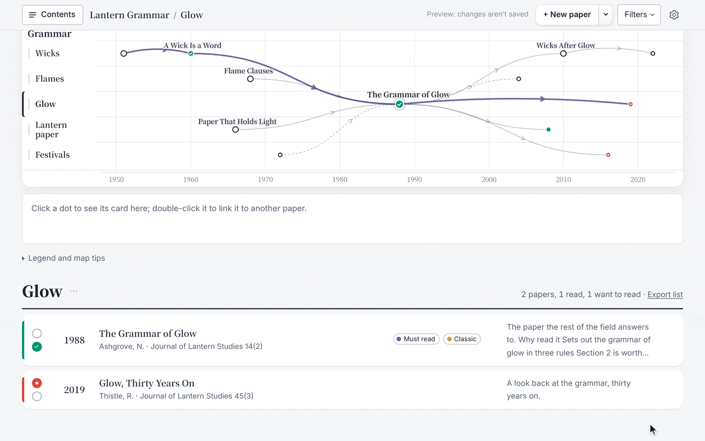
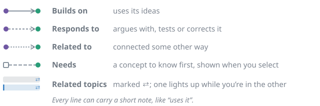
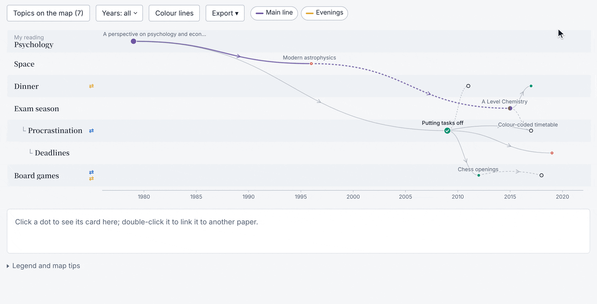
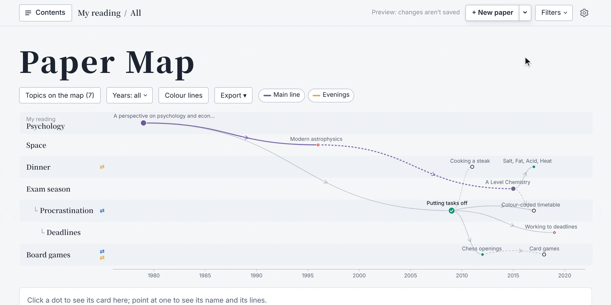
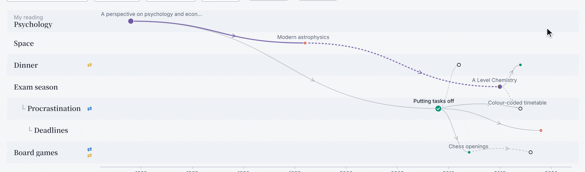
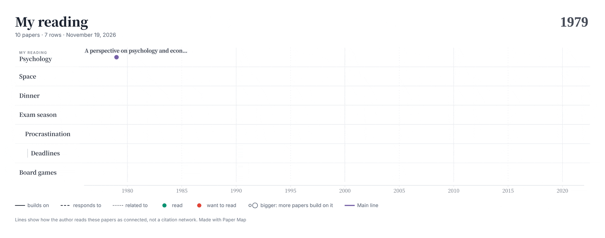
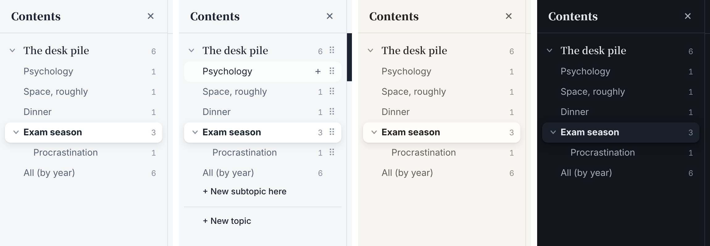

<p align="center">
  <a href="https://liamxluo.github.io/paper-map/"></a>
</p>

<p align="center">
  <a href="https://liamxluo.github.io/paper-map/">Get the app</a> &nbsp;·&nbsp;
  <a href="#how-it-works">How it works</a> &nbsp;·&nbsp;
  <a href="#get-started">Get started</a> &nbsp;·&nbsp;
  <a href="#good-to-know">Good to know</a>
</p>

A personal map of research, ideas and reading. I built it simply because I wanted a better way to organise what I read and understand how ideas connect.


---

## How it works

### Cards



Every topic lists its papers as cards, in time order: green for read, red for want to read. Press one and it turns over into the full card: where it sits (change it right there), its lines on a small timeline, its labels and notes, and its PDF. Its **⋯** edits or deletes it.

### Link with +

Each paper is a dot in its topic's row, at its year. The more papers build on one, the bigger its dot. Each row names up to two of its most connected papers; point at any dot to see its title and authors. Click a dot and its lines light up; **How far**, in the bar under the map, reaches further, up to **Whole line**.





Double-click a dot and it turns into a black **+**. Say how it connects first, **Builds on**, **Leads to** or **Related to**, then click the other paper: the arrow points the right way from the start. Linked it wrongly? Click the line to change it, turn it round, give it a note and a colour, or remove it. Dragging a dot only ever moves it to another row.

### Lens



Press **L**, or **Lens** under the map, to see one paper's line of thought on its own: what it builds on to the left, what it leads to on the right. **Path…** shows the chain that joins any papers you tick, and **Metro** draws it like a metro map.

### Zoom through time


Drag along the years to zoom in on a stretch of time, and drag the map sideways to move through it. Double-click a year to zoom in further; **Years ▾ → All years** shows everything again. Zoom in far enough and every paper is named.

### Mentions another field



A paper can reach into another field without linking to any paper in it: double-click it, choose **↧ Mentions another field** and click that field's row. A faint shadow of its dot appears there, at the same year.

### Watch it grow



**Export ▾ → The map → GIF** makes a moving picture of your map growing, year by year.

## Get started

### I. Get the app

1. Open **[liamxluo.github.io/paper-map](https://liamxluo.github.io/paper-map/)** in Chrome or Edge. It shows a made-up example.
2. Click **Install** at the top right. On iPhone or iPad, tap **Share → Add to Home Screen**.

It opens in its own window, works offline, and updates itself with every release.

<details>
<summary>No Chrome or Edge? Use it as a file</summary>

1. Download [`index.html`](index.html): open it and click **Download raw file**.
2. Double-click it to open it in any browser.

The app and the file keep separate lists. Connect sync in both to share one list, or move it with **Settings → Data → Export backup** and **Import backup**.

</details>

### II. Sync (recommended)

Your list lives in the app until you connect sync; then it is safe, keeps earlier versions, and follows you to every device. Open **Settings → Sync** and choose one.

**GitHub, the most reliable.** Every save is kept for good, and it works on phones too.
1. [Create a private repository](https://github.com/new?name=paper-map-data&visibility=private) and tick **Add a README file**.
2. [Create a token](https://github.com/settings/personal-access-tokens/new?name=Paper+Map&expires_in=366&contents=write): under Repository access choose **Only select repositories** and pick that repository. The link already sets the one permission it needs, **Contents: Read and write**.
3. Paste the token under **Settings → Sync → GitHub** and click **Connect**. Paper Map asks when the token expires, then reminds you two weeks before, with the steps to renew it.

**An iCloud Drive, Dropbox or OneDrive folder.** Under **Settings → Sync → iCloud / Dropbox folder**, click **Choose a folder** and pick one inside iCloud Drive, Dropbox or OneDrive: that app copies it to your other computers and keeps its own history, and Paper Map keeps earlier copies in `data/backups`. No account or token needed. Works in Chrome and Edge on a computer; on a phone, use GitHub.

<details>
<summary>Still confused? First time, or on another device</summary>

- Your whole list is one file, `data/paper-map.json`. Notes are copied into `notes/` for reading, and PDFs go into `pdfs/`.
- On another device, install the app and connect the same way: your list loads from there.
- Changed things on two devices? Paper Map combines them. It only asks about something changed on both, such as the same paper.
- If iCloud Drive, Dropbox or OneDrive ever makes a second copy of the file (two computers at once), Paper Map notices it and offers to combine it into your list.
- A new or empty page never saves over your list: it loads it instead. **Earlier versions** brings back any past save.
- GitHub says the repository can't be found? The token doesn't include it yet: open the token on GitHub and add the repository under **Repository access**.

</details>

### III. Add papers

Click **+ New paper**, paste a DOI or ISBN and click **Fill in**: the title, authors, year and source come back by themselves.

<details>
<summary>Which IDs work</summary>

| Paste | Looked up in |
|---|---|
| A DOI, or a doi.org link | Crossref, DataCite and the other DOI agencies |
| An ISBN, for a book | Open Library, then Google Books |
| An Elsevier PII (S0…) | Crossref, which also finds its DOI |
| An arXiv ID (2101.00001) | arXiv's DOI on DataCite |
| A PubMed or PubMed Central ID | Europe PMC |

</details>

<details>
<summary>Add a paper from any page, with one click</summary>

In **Settings → Data**, drag **+ Paper Map** to your bookmarks bar. On a paper's page (a journal, arXiv, Google Scholar), click it: New paper opens with its DOI and title filled in, and you choose where it goes.

</details>

<details>
<summary>Bring papers in from Zotero, a CSV, BibTeX or RIS file</summary>

Choose **+ New paper ▾ → Import papers**. In Zotero, right-click a collection and choose **Export Collection…** (CSV or BibTeX); any spreadsheet saved as CSV works too. You choose the topic, see every paper with a tick box, and papers already on your map are recognised and left unticked. Undo puts everything back.

</details>

When you mark a paper with a DOI as **Read**, the papers on your map that it cites glow for a moment, so you can link them if you like. Nothing is ever linked for you.

### IV. Notes and PDFs

Open a paper's **Notes & PDF** to write Markdown notes beside its PDF. PDFs need sync. **Settings → Data → Export notes** exports every note at once.

## More

<details>
<summary>Export the map, the list, or both</summary>

**Export ▾** next to Colour lines. **The map** exports by topic, from one paper (as far as How far reaches), along colour lines, or just the papers you pick, as PNG, PDF or GIF; the options sit on the left and the right shows exactly what you'll get. **The papers** saves a list as CSV, BibTeX, RIS or a Markdown reading list. **Both together** puts the map and its list in one PDF, or one long picture for a chat.


</details>

<details>
<summary>Colour lines, all in one place</summary>

Give a main line of thought its own colour from a line's menu. **Colour lines** above the map names them, shows what is on each, and hides one for a while.


</details>

<details>
<summary>Topics, subtopics and related topics</summary>

Top-level topics are big areas, such as a field or a project, with subtopics inside to any depth. A topic has a row of its own too, level with its subtopics, for papers about the topic as a whole: choose **“… itself”** under Subtopic. Drag them around in **Contents**, or use a topic's **⋯** to add, rename, move or delete. Related topics carry ⇄ beside their names and light up together.


</details>

<details>
<summary>Fancy another style?</summary>



Pick Mist, Warm white or Pure white in **Settings → Paper**, and Light, Dark or Match my system in the same place.

</details>

---

## Good to know

**Updates.** The app updates itself: each new release reaches it the next time you open it, with a note saying what's new. **Settings** shows which version you have.

**Your data.** Without sync your list lives only in this browser, and clearing its data deletes it. With sync, a new or empty page loads your list rather than saving over it, and **Settings → Sync → Earlier versions** brings back any past save.

**Undo.** After a change, Undo stays in the top bar for 10 minutes or until your next change (Ctrl or Cmd + Z works too). Every delete says in red how many papers go with it.

**Not a reference manager.** It maps and annotates what you read; it doesn't format citations or keep a library the way Zotero does.

**Your token.** It stays in the browser where you connect. Give it one private repository and **Contents: Read and write** only, and don't connect on shared computers.

**PDFs and copyright.** Attached PDFs are stored in your own repository. Keep it private, and only add papers you may keep a copy of.

**Privacy.** Paper Map connects only to what you choose: your sync (GitHub or a folder); the ID services (Crossref, DataCite, Open Library, Google Books, Europe PMC) when you press **Fill in**; Crossref when you mark a paper with a DOI as Read (switch it off in **Settings → Map**); and GitHub, to see if a new version is out.

**Credits.** The interface and code were built with help from Claude, an AI model made by Anthropic.

<details>
<summary>Repository structure</summary>

```
/
├── index.html              the whole app
├── manifest.webmanifest    lets browsers install it as an app
├── sw.js                   keeps the app working offline (never stores your data)
├── icons/                  the app icon, in each size
├── example/
│   └── displaydata.json    the example on the website
└── assets/                 the pictures in this README
```

</details>
