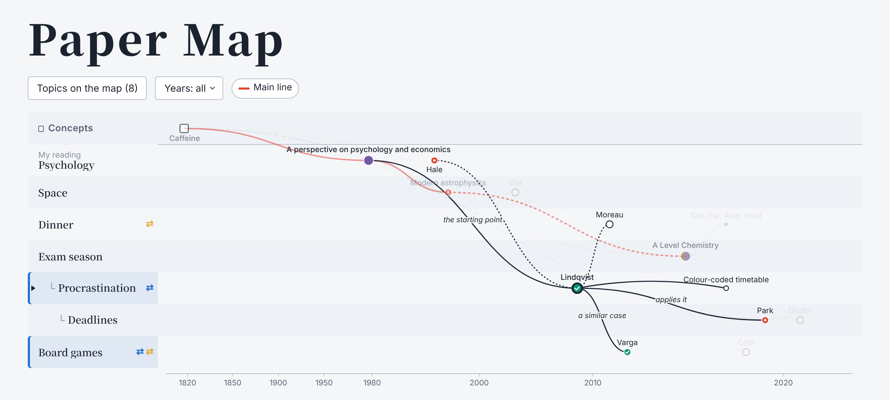
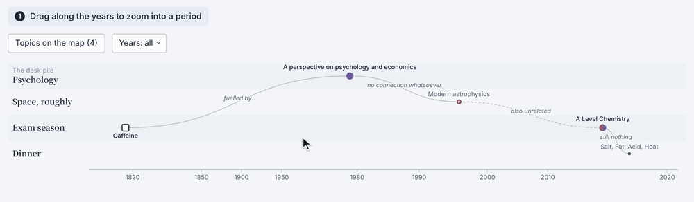
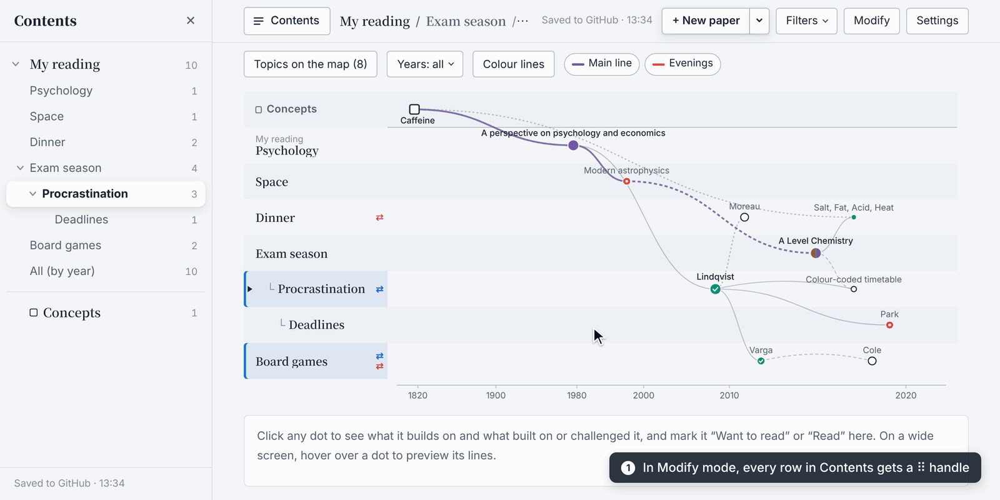
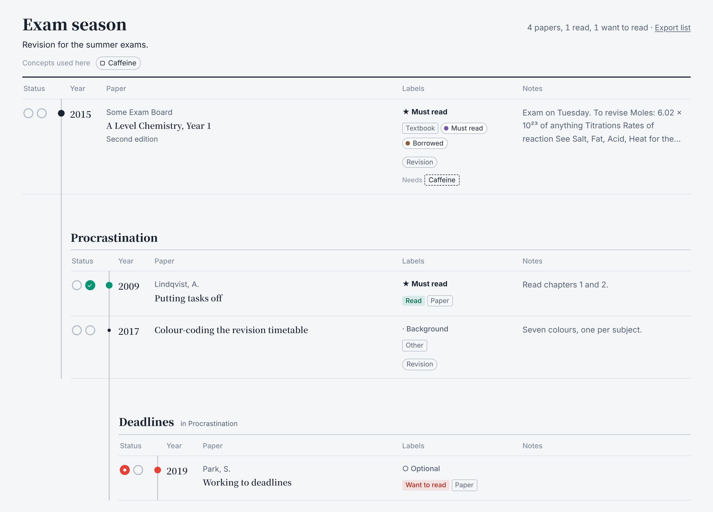

I built this simply because I wanted a better way to organise what I read and understand how ideas connect

**[How it works](#how-it-works)** · **[Get started](#get-started)** · **[Good to know](#good-to-know)**


The live preview (link at the top right of this page) shows a made-up example.

---

## How it works

### Lines


---

## Get started

### I. Open it

One HTML file, nothing to install.

1. Download [`index.html`](index.html): open it and click **Download raw file**.
2. Double-click it to open it in your browser.
3. Click **Modify** to add topics and papers. Everything is saved in that browser.

To start from the example instead, use **Settings → Data → Import backup** and choose `displaydata.json`.

### II. Sync with GitHub (highly recommended)

The copy in your browser is lost if its data is cleared. A private repository of your own keeps every change and every earlier version, and works on any computer.

1. [Create a private repository](https://github.com/new?name=paper-map-data&visibility=private) and tick **Add a README file**.
2. [Create a token](https://github.com/settings/personal-access-tokens/new?name=Paper+Map&expires_in=366&contents=write). Under Repository access, choose **Only select repositories** and pick that repository. Under Permissions, the only one needed is **Contents: Read and write**. The link already sets it, and **Metadata (read-only)** comes with it automatically; remove anything else.
3. In the page, open **Settings → GitHub sync**, paste the token and click **Connect**.

<details>
<summary>Still confused? For first time users, and on another computers</summary>

4. When you click **Connect**, the page creates `data/paper-map.json` in your private repository. That one file is your whole list, so you don't need to make it yourself. Already have a backup? Import it first (**Settings → Data → Import backup**), then connect, and the backup becomes that file.

5. Notes you write are copied into `notes/`, and PDFs you attach go into `pdfs/`. Edit notes in the page; the copies in `notes/` are for reading.

6. If the page says the repository can't be found, the token doesn't include it yet: open the token on GitHub and add the repository under **Repository access**.

7. On another computer, download `index.html` again and paste the token once more.

</details>

### III. Taking Notes and Upload PDFs


PDFs need GitHub sync. To export every note at once, use **Settings → Data → Export notes**.

### IV. Some More Easy Operations you might want to know

<details>
<summary>Zoom the timeline</summary>



</details>

<details>
<summary>Subtopics inside subtopics</summary>



</details>

<details>
<summary>Can't drag, on a phone say? Modify the subtopic and choose its new place under "Inside".</summary>


</details>

<details>
<summary>Lists</summary>

Every topic also opens as a list, with status, notes, tags and concept cards



</details>

- **One field at a time:** **Topics on the map → Current topic only**.

---

## Good to know

**Not a reference manager.** It maps and annotates what you read; it doesn't look up DOIs or format citations the way Zotero does.

**Keep a copy.** Without GitHub sync, your list lives only in this browser, and clearing its data deletes it. Connect sync, or export a backup now and then.

**Your token.** It stays in the browser where you enter it. Give it one private repository and **Contents: Read and write** only, and don't connect on shared computers.

**PDFs and copyright.** Attached PDFs are stored in your own repository. Keep it private and only add papers you may keep a copy of; sharing them is where copyright trouble starts.

**Privacy.** The file holds no data and connects to nothing except your own repository, and only once you set one up.

**Credits.** The interface and code were built with help from Claude, an AI model made by Anthropic.

<details>
<summary>Repository Structure</summary>

```
/
├── index.html              the whole app
├── README.md
├── .gitignore
├── example/
│   └── displaydata.json    the example shown in the live preview
└── assets/
    ├── *.png
    ├── *.gif
    └── *.svg
```

</details>
