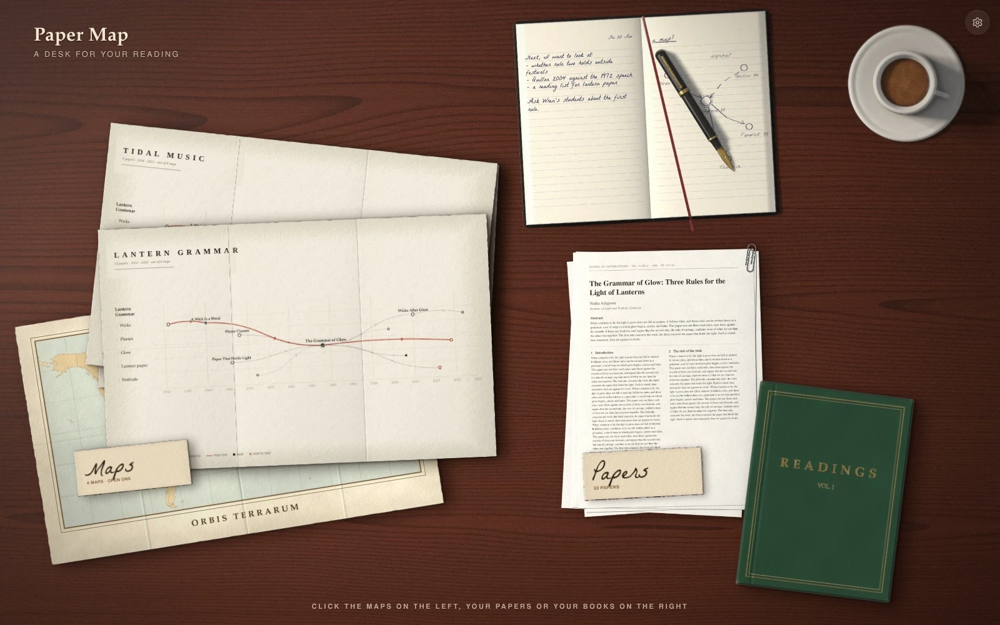

  

<h1 align="center">Paper Map</h1>

Your reading world.

   <a href="https://github.com/liamxluo/paper-map/releases/latest/download/Paper-Map.dmg"><b>Download for macOS</b></a>
  &nbsp;·&nbsp;
   <a href="https://liamxluo.github.io/paper-map/"><b>Open in your browser</b></a>

macOS 11 or later, Apple silicon and Intel &nbsp;·&nbsp; Chrome, Edge or Safari &nbsp;·&nbsp; free and open source (MIT)

<!-- THE VIDEO: in GitHub's editor, drag paper-map-tour.mp4 onto the line below; GitHub replaces it with a link that plays here. -->

  

Paper Map lays the papers of a field out on a timeline and lets you draw how they connect: which builds on which, which answers which, and which line of thought runs through them. Around the map sits a desk: your maps folded on the left, every paper you keep, a book of everything you have read, and a notebook for a research log. All of it is one file that belongs to you.

## A tour

### From the desk to the map

Your maps lie folded on the desk, the one you opened last on top, drawn with your own lines. Click them and every map stands in a row of covers you scroll left and right; choose one and it unfolds into the map, which fills the window. **Desk** folds it back to its cover.

### The map

Papers sit on their years, in rows by topic. Double-click a dot to link it: **Builds on**, **Responds to** or **Related to**. Give a main line of thought its own colour, drag along the years to zoom into a period, and press **L** on a paper to see its whole line on its own.

### Readings and the research log

| | |
|---|---|
|  |  |
| **Readings.** Every book you have read, are reading or want to read, in categories of your own, each with its notes. Put a book on a map and link it like a paper. | **The research log.** The notebook's left page is yours: up to sixty pages, dated as you write, in one of five hands. The right page stays as it is. |

## Get started

### 1. Get Paper Map

- **On a Mac:** download the `.dmg` from [Releases](https://github.com/liamxluo/paper-map/releases/latest), open it and drag Paper Map into Applications. Paper Map isn't signed by Apple, so the first time, open **System Settings → Privacy & Security** and click **Open Anyway**. Only once.
- **In a browser:** open **[liamxluo.github.io/paper-map](https://liamxluo.github.io/paper-map/)**. It shows a made-up example. In Chrome or Edge click **Install** at the top right; on an iPhone or iPad tap **Share → Add to Home Screen**. It works offline and updates itself.

### 2. Choose where your library lives

Your whole library (maps, papers, notes, Readings and notebooks) is one file, `data/paper-map.json`.

| Where | How |
|---|---|
| **iCloud Drive** | The Mac app asks on its first start. A “Paper Map” folder in iCloud Drive keeps your Macs in step. |
| **A folder** | In Chrome or Edge: **Settings → Sync → Choose a folder**, inside iCloud Drive, Dropbox or OneDrive. |
| **GitHub** | Any browser, phones too, with every save kept. Steps below. |
| **Just this app** | Nothing to set up, but nothing is copied anywhere else. |

Connect GitHub

1. [Create a private repository](https://github.com/new?name=paper-map-data&visibility=private) and tick **Add a README file**.
2. [Create a token](https://github.com/settings/personal-access-tokens/new?name=Paper+Map&expires_in=366&contents=write): under Repository access choose **Only select repositories** and pick that repository. The link already sets the one permission it needs, **Contents: Read and write**.
3. Paste the token under **Settings → Sync → GitHub** and click **Connect**. Paper Map reminds you two weeks before the token expires.

On another device, or two at once

- Connect the same way on the other device: your library loads from there.
- Changed things on two devices? Paper Map combines them, and only asks about something changed on both.
- If iCloud Drive, Dropbox or OneDrive makes a second copy of the file, Paper Map offers to combine it.
- A new or empty app never saves over your library: it loads it instead. **Earlier versions** brings back any past save.

### 3. Add papers

Click **+ New paper**, paste a DOI or ISBN and click **Fill in**: the title, authors, year and source fill themselves in.

Which IDs work

| Paste | Looked up in |
|---|---|
| A DOI, or a doi.org link | Crossref, DataCite and the other DOI agencies |
| An ISBN, for a book | Open Library, then Google Books |
| An Elsevier PII (S0…) | Crossref, which also finds its DOI |
| An arXiv ID (2101.00001) | arXiv's DOI on DataCite |
| A PubMed or PubMed Central ID | Europe PMC |

From any page, or from Zotero

- **+ Paper Map** in **Settings → Data** goes on your bookmarks bar. On a paper's page, click it and New paper opens with its DOI and title filled in.
- **+ New paper ▾ → Import papers** brings in a Zotero export (CSV or BibTeX), a RIS or CSL JSON file, or any spreadsheet saved as CSV. Papers already on your map are recognised and left out.

When you mark a paper **Read**, Paper Map looks up what it cites: papers on your map that it cites, and that aren't linked to it yet, pulse for a minute so you can link them if you like. Nothing is ever linked for you.

## Using Paper Map

- **Topics.** A top-level topic is a big area, a field or a project, with subtopics inside to any depth. Drag them around in **Contents**, or use a topic's **⋯**.
- **Lines.** Builds on is solid, Responds to is dashed, Related to is dotted. A paper that **mentions another field** leaves a grey shadow in that field's row.
- **Colour lines.** Give a main line of thought a colour from a line's menu; **Colour lines** above the map names them and hides one for a while.
- **Lens.** Select a paper and press **L**: its whole line on its own, the path between two papers, or a metro map.
- **Notes and PDFs.** Every paper has Markdown notes beside its PDF. PDFs need sync.
- **Papers.** The pages on the desk: every paper as a page stamped READ or TO READ, by map or by mark. Click one and it opens into the paper's own page: its notes, its status, where it sits and every line to and from it.
- **Export.** The map as PNG, vector PDF or a GIF of it growing over the years; the list as BibTeX, RIS, CSV or Markdown.
- **Look.** The desk's wood, creased or smooth map paper, Mist, Warm white or Pure white, Light or Dark, and whether Paper Map opens on the desk or on the last map.

## Good to know

**Your data.** It stays where you put it: in the app, your folder or your repository. Paper Map has no server and no account. It connects only to your sync, to the ID services when you press **Fill in**, to Crossref when you mark a paper Read, and to GitHub to see whether a new version is out.

**Updates.** The web version updates itself; the Mac app tells you when a new version is out. **Settings** shows which version you have.

**Undo.** After a change, Undo stays in the top bar for 10 minutes (Cmd or Ctrl + Z works too). Every delete says in red how many papers go with it.

**Not a reference manager.** Paper Map maps and annotates what you read. For citations in your writing, keep Zotero beside it: Paper Map imports from it and exports BibTeX and RIS.

**Your token and your PDFs.** The GitHub token stays in the app where you connect it; give it one private repository and nothing else. PDFs live in your own repository or folder: keep it private, and only add papers you may keep a copy of.

Building Paper Map

The app is plain HTML, CSS and JavaScript, split by subject:

| Folder | What is in it |
|---|---|
| `src/app/` | The app: `head.html`, `body.html`, `styles/` and `js/`, joined in the order listed in `order.json` |
| `src/desk/` | The desk: its styles, markup and script |
| `scripts/build.mjs` | Joins them into `index.html` (the web version) and `dist/` (the Mac app's files) |
| `src-tauri/` | The Mac app: its window, icons, DMG window and a few native commands |

- **Change something:** edit a file in `src/`, run `node scripts/build.mjs` (Node 18 or later) and reload `index.html`.
- **Make the Mac app on your Mac:** double-click `build-mac.command`. The first time it installs Apple's command line tools and Rust (Node.js you install yourself), then it makes the `.dmg` and shows it in Finder.
- **Release:** publish a release on GitHub. GitHub Actions makes the Mac app on GitHub's Macs and attaches it to that release, also as `Paper-Map.dmg`, which **Download for macOS** always points at.

---

The interface and code were built with help from Claude, an AI model made by Anthropic. MIT licence.

