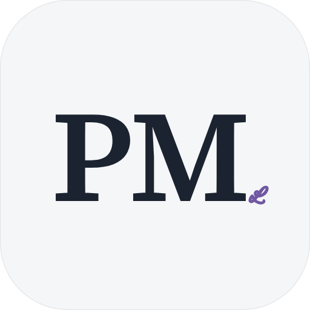
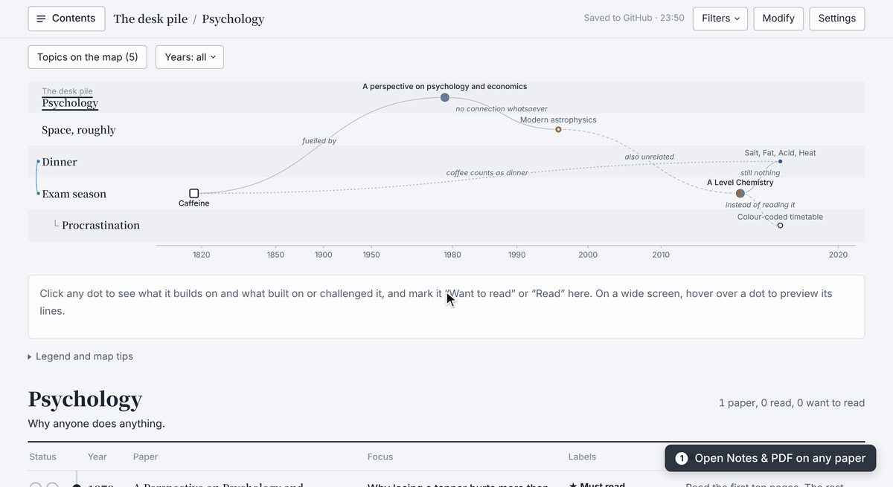
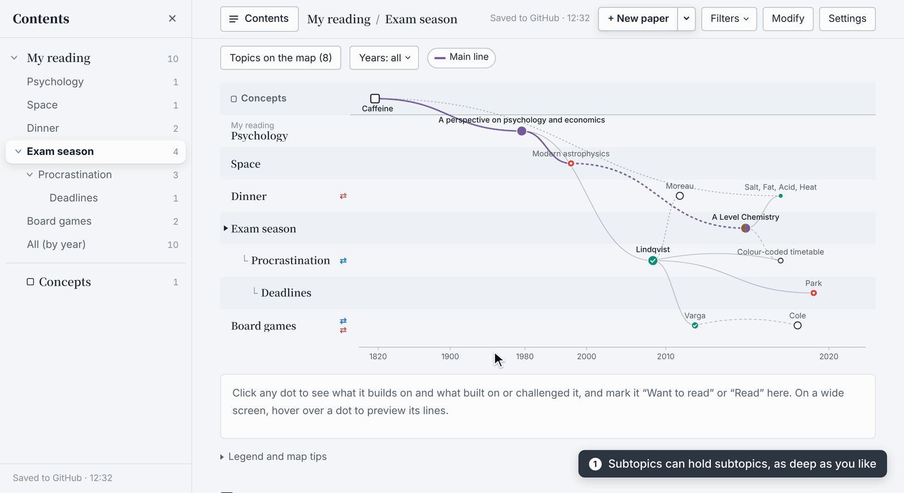
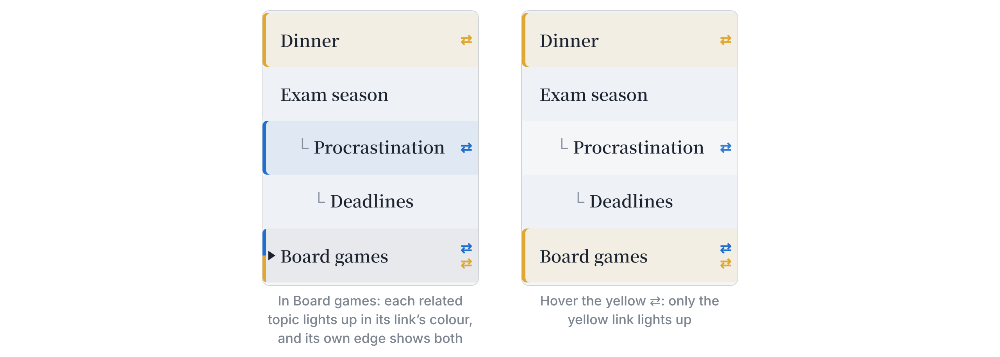
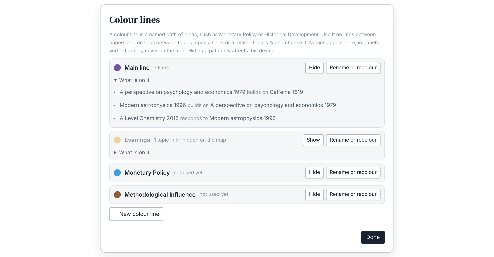

<p align="center">
  <a href="https://liamxluo.github.io/paper-map/"></a>
</p>

<p align="center">
  <a href="https://liamxluo.github.io/paper-map/">Get the app</a> &nbsp;·&nbsp;
  <a href="#how-it-works">How it works</a> &nbsp;·&nbsp;
  <a href="#get-started">Get started</a> &nbsp;·&nbsp;
  <a href="#good-to-know">Good to know</a>
</p>

I built this simply because I wanted a better way to organise what I read and understand how ideas connect.


---

## How it works

### Lines


Click a paper to light up the lines around it; notes on lines appear only then, so the map stays clean. **How far** in its panel goes further, up to **Whole line**: every paper connected to it.

Give a main line of thought its own colour from a line's ✎. **Colour lines** above the map keeps them in one place: name a path, see what is on it, or hide it for a while.

### Topics

Top-level topics are big areas, such as a field or a project. Related topics carry ⇄ beside their names and light up together; colour a link to say which path it belongs to.

### Concepts

A concept is an idea papers need, with the year it appeared, such as Nash equilibrium (1950). Concepts have their own row at the top of the map and their own page in Contents. Add one from **+ New paper ▾ → Concept**, or from a paper's Prerequisite concepts.

---

## Get started

### I. Get the app

1. Open **[liamxluo.github.io/paper-map](https://liamxluo.github.io/paper-map/)** in Chrome or Edge. It shows a made-up example.
2. Click **Install** at the top right.

It opens in its own window, works offline, and updates itself with every release.

<details>
<summary>No Chrome or Edge? Use it as a file</summary>

1. Download [`index.html`](index.html): open it and click **Download raw file**.
2. Double-click it to open it in any browser.

The app and the file keep separate lists. Connect GitHub sync in both to share one list, or move it with **Settings → Data → Export backup** and **Import backup**.

</details>

### II. Sync with GitHub (recommended)

A private repository of your own keeps your list safe, keeps every earlier version, and brings it to any computer.

1. [Create a private repository](https://github.com/new?name=paper-map-data&visibility=private) and tick **Add a README file**.
2. [Create a token](https://github.com/settings/personal-access-tokens/new?name=Paper+Map&expires_in=366&contents=write): under Repository access choose **Only select repositories** and pick that repository. The link already sets the one permission it needs, **Contents: Read and write**.
3. In the app, open **Settings → GitHub sync**, paste the token and click **Connect**.

<details>
<summary>Still confused? First time, or on another computer</summary>

- Connecting creates `data/paper-map.json` in your repository. That one file is your whole list. Notes are copied into `notes/` for reading, and PDFs go into `pdfs/`.
- On another computer, install the app and connect with the same token: your list loads from GitHub.
- If the repository can't be found, the token doesn't include it yet: open the token on GitHub and add the repository under **Repository access**.

</details>

### III. Notes and PDFs



PDFs need GitHub sync. **Settings → Data → Export notes** exports every note at once.

### IV. More you might want to know

<details>
<summary>Zoom the timeline</summary>


</details>

<details>
<summary>Subtopics inside subtopics</summary>


</details>

<details>
<summary>Can't drag, on a phone say?</summary>

Modify the subtopic and choose its new place under **Inside**.



</details>

<details>
<summary>Move a paper, or hide rows for a while</summary>

Drag a paper's dot up or down to another row, or drag its year in the list onto a topic in Contents. To hide rows, untick them in **Topics on the map**; **Show all** brings them back.

</details>

<details>
<summary>Lists</summary>


</details>

<details>
<summary>Related topics, in colour</summary>



</details>

<details>
<summary>Colour lines, all in one place</summary>



</details>

<details>
<summary>Fancy another style?</summary>


Pick Mist, Warm white or Pure white in **Settings → Paper**, and Light, Dark or Match my system in the same place.

</details>

---

## Good to know

**Updates.** The app updates itself: each new release reaches it the next time you open it, with a note saying what's new. **Settings** shows which version you have.

**Your data.** Without GitHub sync your list lives only in this browser, and clearing its data deletes it. With sync, a new or empty page loads your list from GitHub rather than saving over it, and **Settings → GitHub sync → Earlier versions** brings back any past save.

**Undo.** After a change, Undo stays in the top bar for 10 minutes or until your next change (Ctrl or Cmd + Z works too). Every delete says in red how many papers go with it.

**Not a reference manager.** It maps and annotates what you read; it doesn't look up DOIs or format citations the way Zotero does.

**Your token.** It stays in the browser where you enter it. Give it one private repository and **Contents: Read and write** only, and don't connect on shared computers.

**PDFs and copyright.** Attached PDFs are stored in your own repository. Keep it private, and only add papers you may keep a copy of.

**Privacy.** Paper Map connects to nothing except your own repository, and only once you set one up.

**Credits.** The interface and code were built with help from Claude, an AI model made by Anthropic.

<details>
<summary>Repository structure</summary>

```
/
├── index.html              the whole app
├── manifest.webmanifest    lets browsers install it as an app
├── sw.js                   keeps the app working offline (never stores your data)
├── icons/                  the app icon, in each size
├── example/
│   └── displaydata.json    the example on the website
└── assets/                 the pictures in this README
```

</details>
