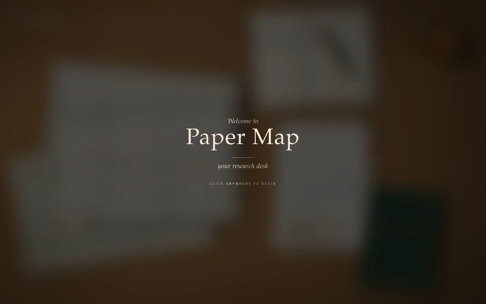

  

<h1 align="center">Paper Map</h1>

<b>Your research desk.</b> Every paper. Every book. Every note. On one desk.

   <a href="https://github.com/liamxluo/paper-map/releases/latest/download/Paper-Map.dmg"><b>Download for macOS</b></a>
  &nbsp;·&nbsp;
   <a href="https://liamxluo.github.io/paper-map/"><b>Try the web app</b></a>

macOS 11 or later, Apple silicon and Intel &nbsp;·&nbsp; Chrome, Edge or Safari &nbsp;·&nbsp; free and open source (Apache-2.0)

**Your papers and your books, in one library.** Papers in folders, books on shelves with their covers, how far you have read, and every highlight, Kindle and Goodreads included.

**Read where you write.** Open a paper or a book and it lies open on your desk: the PDF or the EPUB on the left, an A4 sheet of your own notes on the right. Select a line and it is quoted into your notes with its page. Highlight it, or stick a note on the page.

**Works with Zotero.** Save a paper from any website with the Zotero Connector and it is on your desk. Read on your phone in Zotero, and your highlights and notes are waiting when you sit down.

**Think in maps, when it is time to think.** For a review, a chapter or a question: lay the papers out on a boundless mind map, with lines in colour and words on them, or as a timeline of who built on whom. **Export either as a true vector PDF or SVG**: real lines and real, selectable text, sharp at any size, ready for a paper or a slide.

## Opening it on a Mac for the first time

Paper Map is not yet signed with a paid Apple Developer ID, so the first time you open it, macOS says it cannot check the app for malicious software. That is about the missing signature, not about anything found in the app.

1. Open **Paper-Map.dmg** and drag **Paper Map** into **Applications**.
2. Open Paper Map. When the warning appears, click **Done**.
3. Open **System Settings → Privacy & Security**, click **Open Anyway** beside Paper Map, and confirm.

You do this once; updates install themselves after that. If macOS says the app “is damaged”, run `xattr -cr "/Applications/Paper Map.app"` in Terminal and open it again.

Every line of its code is in this repository, and GitHub builds the app from it, in public, for every release ([the builds](https://github.com/liamxluo/paper-map/actions)). An update only installs if it carries the project's signature.

## Your data stays yours

- **There is no Paper Map server.** Your library is kept on your Mac, or in your own private GitHub repository, iCloud Drive or Dropbox if you choose.
- **No account, no tracking, no analytics, no ads, no AI.**
- **It goes online only for what you ask:** syncing, looking up a DOI or ISBN, Zotero if you connect it, and checking for a new version.

## Get started

1. **Install it**, or [try the web app](https://liamxluo.github.io/paper-map/), which opens with an example. To use your own library in the browser, open [the app](https://liamxluo.github.io/paper-map/?app) instead.
2. **Choose where your library lives**: on its first start the Mac app offers iCloud Drive, this Mac only, or GitHub. You can change it any time from the cloud on the map page.
3. **Add papers**: connect Zotero in the cloud, or click **+** and paste a DOI, an ISBN or a paper's web address.

Connect GitHub

**Once, and Paper Map does the rest**

1. [Create a token](https://github.com/settings/personal-access-tokens/new?name=Paper+Map&description=Lets+Paper+Map+make+and+keep+its+private+repositories&expires_in=366&contents=write&administration=write). Under **Repository access**, choose **All repositories**. Its two permissions, **Contents** and **Administration** (read and write), are already filled in. It lasts a year.
2. Click the cloud on the map page, paste the token under **GitHub** and click **Connect**.

Paper Map then makes three private repositories of yours, each when it is first needed:

| Repository | What it keeps |
|---|---|
| `paper-map-data` | Your library: the list of papers, notes, highlights, maps, mind maps and the research log. Every version is kept. |
| `paper-map-pdfs` | PDFs, books, and pictures on your mind maps. |
| `paper-map-notes` | Handwriting: one file for each paper, book or mind map. |

When `paper-map-pdfs` or `paper-map-notes` nears 1 GB, the next one is made (`paper-map-pdfs-2`, `paper-map-notes-2`, …), and what is already kept stays where it is. Their history is cleared at most once a week, and only when it has grown well past what they hold. Your library's history is never cleared.

**Private, always.** Before it writes to any repository, Paper Map asks GitHub whether it is private, and writes only if GitHub says it is. A public repository is refused: nothing is written to it, and Paper Map tells you how to make it private. The token is sent only to GitHub, in each request's header; it is never written into your library or into any file.

**Prefer a narrower token?** Create the three repositories yourself ([paper-map-data](https://github.com/new?name=paper-map-data&visibility=private), [paper-map-pdfs](https://github.com/new?name=paper-map-pdfs&visibility=private), [paper-map-notes](https://github.com/new?name=paper-map-notes&visibility=private)), then [create a token](https://github.com/settings/personal-access-tokens/new?name=Paper+Map&description=Lets+Paper+Map+save+to+its+private+repositories&expires_in=366&contents=write) for those three only, with **Contents: Read and write**. Everything works the same; when a repository nears 1 GB, Paper Map tells you the name of the next one to make.

A token that may make repositories may also change or delete them. Paper Map never deletes a repository; keep the token on your own devices, and make a new one if a device is lost.

Changes made on two devices are combined field by field; Paper Map asks only when the very same thing was changed on both.

Building Paper Map

Plain HTML, CSS and JavaScript in `src/`, joined by `node scripts/build.mjs` into `index.html` (the web app) and `dist/` (the Mac app's files, made with Tauri in `src-tauri/`). Publishing a release on GitHub builds the Mac app and attaches it to the release.

---

Built with help from Claude, an AI model made by Anthropic. <a href="LICENSE">LICENSE</a> · <a href="NOTICE">NOTICE</a>

