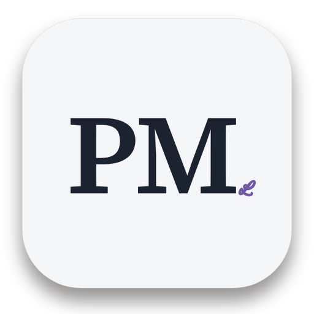
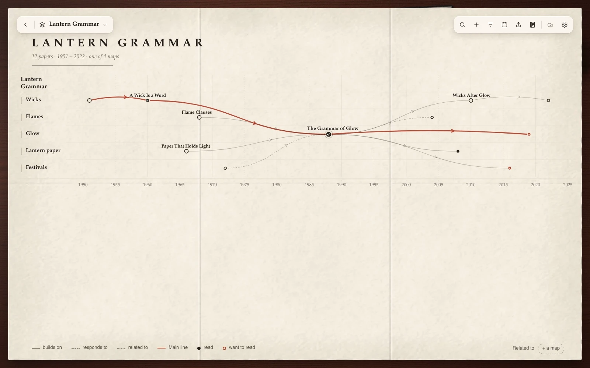
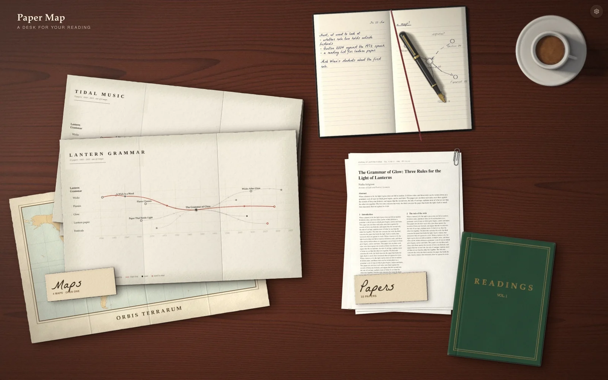

  

<h1 align="center">Paper Map</h1>

Your reading world.

   <a href="https://github.com/liamxluo/paper-map/releases/latest/download/Paper-Map.dmg"><b>Download for macOS</b></a>
  &nbsp;·&nbsp;
   <a href="https://liamxluo.github.io/paper-map/"><b>Open the web app</b></a>

macOS 11 or later, Apple silicon and Intel &nbsp;·&nbsp; Chrome, Edge or Safari &nbsp;·&nbsp; free and open source (Apache-2.0)

Paper Map lays the papers of a field out on a timeline and lets you draw how they connect: which builds on which, which answers which, and which line of thought runs through them. Around the map sits a desk: your maps folded on the left, every paper you keep, a book of everything you have read, and a notebook for a research log. All of it is one file that belongs to you.

## A tour

### The map

Your maps lie folded on the desk, the one you opened last on top. Click them and every map stands in a row of covers you scroll left and right; choose one and it unfolds into the map. **‹** folds it back to its cover.

The map lies on your desk as one sheet with two small bars: your maps on the left; search, new paper, filters, years, export, the notebook, sync and the gear on the right. Papers sit on their years, in rows by topic. Click a paper and its card opens: the **target** links it to another paper (the line follows your mouse to the next paper you click), the page opens its notes and PDF, the little **metro map** opens Lens, and **⋯** grows into the whole card. Double-clicking a dot links it too, choosing **Builds on**, **Leads to** or **Related to** first. Drag along the years to zoom into a period.

### Readings and the research log

| | |
|---|---|
|  |  |
| **Readings.** Every book you have read, are reading or want to read, in categories of your own, each with its notes. Put a book on a map and link it like a paper. | **The research log.** Notebooks of sixty pages, dated as you write, in one of five hands. Keep as many as you like and choose which one to write in. |

## Get started

### 1. Choose the Mac app or the web app

They are the same Paper Map. The difference is where it runs and where it keeps your library.

**The Mac app.** [Download Paper-Map.dmg](https://github.com/liamxluo/paper-map/releases/latest/download/Paper-Map.dmg), open it and drag Paper Map into Applications. It isn't signed by Apple, so the first time, open **System Settings → Privacy & Security** and click **Open Anyway**. Only once. On its first start it asks where to keep your library: **iCloud Drive**, which keeps all your Macs in step, **this Mac only**, or **GitHub**.

**The web app.** [Open Paper Map in your browser](https://liamxluo.github.io/paper-map/): nothing to download, and it runs on Windows, Linux, iPhone and iPad too. It starts with a made-up example. Install it to have it as an app: in Chrome or Edge click **Install** in the address bar; in Safari on a Mac choose **File → Add to Dock**; on an iPhone or iPad tap **Share → Add to Home Screen**. It works offline and updates itself. Your library stays in that browser until you connect sync.

### 2. Choose where your library lives

Your whole library (maps, papers, notes, Readings and notebooks) is one file, `data/paper-map.json`. Click the **cloud** on the map page to see where it is kept and to change it.

| Where | How |
|---|---|
| **iCloud Drive** | The Mac app asks on its first start. A “Paper Map” folder in iCloud Drive keeps your Macs in step. |
| **A folder** | In the web app, in Chrome or Edge: cloud → **iCloud / Dropbox folder** → **Choose a folder**. |
| **GitHub** | Any browser, phones too, with every save kept. Steps below. |
| **Just this app** | Nothing to set up, but nothing is copied anywhere else. |

Connect GitHub

1. [Create a private repository](https://github.com/new?name=paper-map-data&visibility=private) and tick **Add a README file**.
2. [Create a token](https://github.com/settings/personal-access-tokens/new?name=Paper+Map&expires_in=366&contents=write): under Repository access choose **Only select repositories** and pick that repository. The link already sets the one permission it needs, **Contents: Read and write**.
3. Click the cloud on the map page, paste the token under **GitHub** and click **Connect**. Paper Map reminds you two weeks before the token expires.

On another device, or two at once

- Connect the same way on the other device: your library loads from there.
- Changed things on two devices? Paper Map combines them field by field: a title changed here and notes written there both stay, notes added on both sides are both kept, and a notebook is combined page by page. It asks only when the very same field was changed differently on both, or when a paper was deleted on one and changed on the other. A line drawn to a paper the other device deleted is left out, and Paper Map says so. A save that is interrupted is simply tried again: your library on GitHub is never left half-written.
- If iCloud Drive, Dropbox or OneDrive makes a second copy of the file, Paper Map offers to combine it.
- A new or empty app never saves over your library: it loads it instead. **Earlier versions** in the cloud brings back any past save.

### 3. Add papers

Click **+**, choose **Paper**, paste a DOI, an ISBN or the paper's web address and click **Fill in**: the title, authors, year and source fill themselves in.

Which IDs work

| Paste | Looked up in |
|---|---|
| A DOI, or a doi.org link | Crossref, DataCite and the other DOI agencies |
| An ISBN, for a book | Open Library, then Google Books |
| An Elsevier PII (S0…) | Crossref, which also finds its DOI |
| An arXiv ID (2101.00001) | arXiv's DOI on DataCite |
| A PubMed or PubMed Central ID | Europe PMC |
| A paper's web address (a publisher, JSTOR, SSRN, NBER, a library…) | Zotero's translators, through Wikipedia's free citation service |

When the registries have no record of an ID, Paper Map asks Zotero's translators as well. No account is needed, and none of it costs anything.

From any page, or from Zotero

- **+ Paper Map**, in the gear on the map page, goes on your bookmarks bar. On a paper's page, click it and New paper opens with its DOI and title filled in.
- **+ → Import papers** brings in a Zotero export (CSV or BibTeX), a RIS or CSL JSON file, or any spreadsheet saved as CSV. Papers already on your map are recognised and left out.

When you mark a paper **Read**, Paper Map looks up what it cites: papers on your map that it cites, and that aren't linked to it yet, pulse for a minute so you can link them if you like. Nothing is ever linked for you.

## Using Paper Map

- **Topics.** A map is a field or a project, with topics inside it to any depth. In **Contents**, under the map's name ▾, the **⋯** beside a topic adds a subtopic inside it, renames or deletes it; drag topics to reorder them. **Papers** on the desk shows the same tree, and choosing a topic shows the papers in it and in everything inside it.
- **Lines.** **Double-click a dot** to link it: choose Builds on, Leads to or Related to, then click the other paper. The target on a paper's card links it too. Builds on is solid, Responds to is dashed, Related to is dotted. A paper that **mentions another field** leaves a grey shadow in that field's row. Give a main line of thought its own colour from a line's menu; click its name in the legend to rename or hide it.
- **Lens.** The metro icon on a paper's card, or **L**: its whole line on its own, the path between two papers, or a metro map.
- **Related maps.** **Related to**, in the bottom-right corner of a map, notes which other maps belong with it, without merging them. Click one to open it; × unrelates them.
- **Merge maps.** The map's name ▾ → **Merge into another map…** makes it a topic inside another map. Undo is right there afterwards.
- **A map's colour.** In Your maps, the dot on a cover chooses its colour.
- **Papers.** Every paper as a page stamped READ or TO READ; one whose PDF you added shows the PDF's first page. Click a page for the paper's own page: its notes, status, priority and tags, which you change right there, and every line to and from it.
- **The research log.** The notebook icon on the map page brings up a page of your notebook right over the map; click anywhere else and it goes back. On the desk, the notebook icon lists your notebooks and starts a new one.
- **Export.** The map as PNG, vector PDF or a GIF of it growing over the years; the list as BibTeX, RIS, CSV or Markdown.
- **New to Paper Map?** In the gear: a short tour on the real page, ending with your first line between two papers.
- **The gear.** The desk's wood, creased or smooth paper, and whether Paper Map opens on the desk or on the last map.

## Good to know

**Your data.** It stays where you put it: in the app, your folder or your repository. Paper Map has no server and no account. It connects only to your sync, to the ID services when you press **Fill in**, to Crossref when you mark a paper Read, and to GitHub to see whether a new version is out.

**Updates.** The web app updates itself; the Mac app tells you when a new version is out. The gear shows which version you have.

**Undo.** After a change, Undo stays at the top for 10 minutes (Cmd or Ctrl + Z works too). Every delete says in red how many papers go with it.

**Not a reference manager.** Paper Map maps and annotates what you read. For citations in your writing, keep Zotero beside it: Paper Map imports from it and exports BibTeX and RIS.

**Your data and its safety.**
- **One file, versioned.** Your library is one JSON file with a schema version, so a file from any earlier Paper Map opens and is brought up to date, and back-ups and exports stay plain JSON. In the browser it is kept in IndexedDB as well, which has room to grow.
- **No server.** Paper Map is a page and an app that run on your own computer. Your library goes only where you choose to keep it; all the code it runs ships with it, nothing is loaded from anyone else's server.
- **The GitHub token** is kept on this device only and is never sent anywhere but GitHub: in the Mac app it lives in the macOS Keychain, in the web app in the browser's own storage for this site. Make it for one private repository with the single permission it needs, and an expiry date: Paper Map reminds you two weeks before. Lost a device? Delete the token on GitHub (Settings → Developer settings → Personal access tokens) and it stops working at once.
- **Every save is kept.** On GitHub every version of your library stays in the repository's history; the cloud's **Earlier versions** brings any back. The Mac app keeps a daily copy in the folder's backups. **Back up** in the gear saves the whole library as one file; **Restore** reads it back.
- **PDFs** are files beside your library, one per paper. The cloud shows how many you have and how much room they take. **Check the PDFs** lists missing PDFs (the paper is there, its file is not), unlinked PDFs (files of your own with no paper yet, which Paper Map never touches), orphaned files left by papers you deleted (removed only if you confirm), and the storage used. On GitHub each file can be up to 100 MB (papers are usually a few), and a repository is best kept under a few gigabytes; for a large PDF collection, iCloud Drive or a folder is the better place. Keep the repository private, and only add papers you may keep a copy of.

**Licence.** Paper Map is under the Apache License 2.0. You may use it, change it and build on it, commercially too, as long as you keep the copyright and the attribution in [NOTICE](NOTICE), say which files you changed, and do not use the Paper Map name for your own product. Versions up to 3.0.1 were released under MIT. If you use Paper Map in something commercial, I'd be glad to hear about it: open an issue on GitHub.

Building Paper Map

The app is plain HTML, CSS and JavaScript, split by subject:

| Folder | What is in it |
|---|---|
| `src/app/` | The app: `head.html`, `body.html`, `styles/` and `js/`, joined in the order listed in `order.json` |
| `src/desk/` | The desk: its styles, markup and script |
| `scripts/build.mjs` | Joins them into `index.html` (the web app) and `dist/` (the Mac app's files) |
| `src-tauri/` | The Mac app: its window, icons, DMG window and a few native commands |

- **Change something:** edit a file in `src/`, run `node scripts/build.mjs` (Node 18 or later) and reload `index.html`.
- **Make the Mac app on your Mac:** double-click `build-mac.command`. The first time it installs Apple's command line tools and Rust (Node.js you install yourself), then it makes the `.dmg` and shows it in Finder.
- **Release:** publish a release on GitHub. GitHub Actions makes the Mac app on GitHub's Macs and attaches it to that release, also as `Paper-Map.dmg`, which **Download for macOS** always points at.

---

The interface and code were built with help from Claude, an AI model made by Anthropic. Apache License 2.0, see <a href="LICENSE">LICENSE</a> and <a href="NOTICE">NOTICE</a>.

