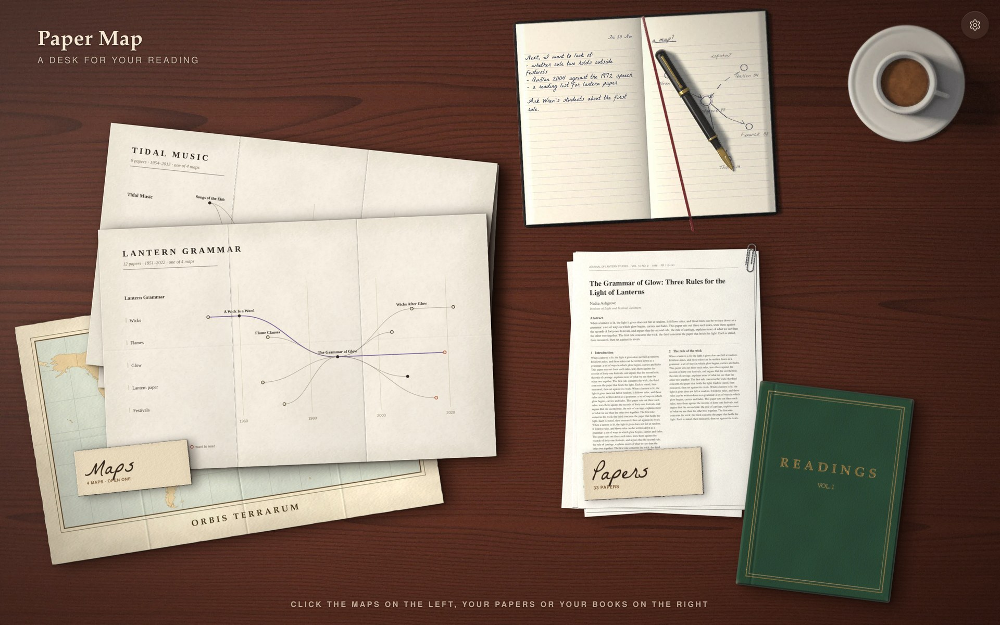

# Paper Map 3.0: the desk

Paper Map now opens on a desk, and comes as a Mac app too: your maps folded on the left, your papers and a book of your Readings on the right, a notebook for a research log, and a cup.

Each time it opens, a soft veil welcomes you (*Welcome to Paper Map, your reading world*) before the desk comes into focus.

## Paper Map for Mac
- A Mac app as well as the web version: download the **.dmg** below, open it and drag Paper Map into Applications (Apple silicon and Intel, macOS 11 or later).
- It is not signed by Apple, so the first time you open it, go to **System Settings → Privacy & Security** and click **Open Anyway**. Only once.
- On its first start it asks where to keep your library: **iCloud Drive**, **This Mac only** or **GitHub**. iCloud Drive keeps a “Paper Map” folder in sync on all your Macs, with a daily backup, and combines the copies if two Macs change it at once.
- Exports go to Downloads, and web links open in your browser.

## Your maps
- Three folded sheets on the desk, always three, whatever the number of maps you have. The top two show the maps you opened last, with your own lines.
- Click them and the maps fold into **Your maps**: every map as a cover on one strip you scroll left and right, like brochures on a stand. **New map** waits at the end.
- Click a cover and it unfolds, panel by panel, into the map, which now fills the window with its controls floating over it. **Desk** folds it back to its cover.

## Papers
- Every paper on your maps as an A4 page, stamped **READ** or **TO READ**.
- Filter by map or by mark, or search by title, author or year.
- Click a page and it opens into the paper's own page: its notes, its status (change it there), labels, where it sits, and every line to and from it, each of which opens that paper's page. **Show it on its map** goes to it on the map, and **Desk** brings you back to the page.

## Readings
- A reading list of its own: every book you have read, are reading or want to read, grouped by the year you finished it.
- Categories of your own, separate from your maps. Each book has its notes, its status and the month you finished it.
- **Put on a map…** adds the book to a map as a book you can link like any paper. On the map it is a small book instead of a dot. Its title, authors and year follow your Readings when you change them there; the book stays in Readings either way, and goes on each map only once.
- The book opens where it lies, and its title page opens out into Readings.

## The research log
- The notebook's left page is yours: up to sixty pages, each dated the day you first write on it. The drawing on the right page stays as it is.
- Five hands to write in: Handwriting, Times New Roman, Georgia, Helvetica, Courier.
- Turn pages with the arrows beside the page (or Alt + ← / →). When a notebook is full, **Start a new notebook** appears on its last page; full notebooks are kept under **Past books**.

## Look and the cup
- The small gear: the desk (mahogany, oak, walnut, linen), the paper (creased or smooth), and whether Paper Map opens on **the desk** or on **the last map**.
- Click the cup for an espresso, a latte or tea.

## Also new since 1.x
3.0 also brings everything that was made for 2.0:
- **Link with +:** double-click a dot, say how it connects (Builds on, Leads to, Related to), then click the other paper.
- **Cards:** every topic lists its papers as cards that turn over into the full card.
- **Lens** (press L): one paper's line of thought on its own, the path between papers, and a metro map.
- **Mentions another field:** a paper's grey shadow in a field it reaches into.
- **Watch it grow:** Export → The map → GIF.
- **A new look** like a printed atlas, names that never crowd, dots that grow with the papers built on them, arrows on the lines, and two taps on a phone.
- **No more Modify mode:** everything is where you point, with ⋯ menus and right-click.
- **+ Paper Map** for your bookmarks bar, and **a reading reminder** that looks up what a paper you have read cites.
- **Export:** GIF as well as PNG and PDF, vector PDFs, names with authors, and an export window with a sharp preview.

## Your data
- New in your data file: `readings`, `readingCats`, `notebooks`, and `settings.desk`. Older files open as before.
- Everything syncs the way your maps do, through GitHub or a folder. Books, categories and notebooks are combined one by one when two devices both changed things; if the same book was changed on both, you choose which to keep.
- A book put on a map is an entry with `"book": true` and `"reading"` pointing to its Readings entry.

## Removed
- **Concepts,** with their row, their years and their prerequisite lines: papers now mention another field instead. Any concepts are removed the first time you open 3.0; your papers and their lines stay.
- **Modify mode,** **Priority** in Filters (it is still on each card), and **the table** (lists are cards now).

## Upgrading
- Nothing to do: the app updates itself the next time you open it. Your papers, lines, notes and sync stay as they are. If you used concepts, export a backup before you open 3.0.
- The desk loads its pictures from `assets/desk/` (about 2 MB; only the desk colour you choose is downloaded), and they are kept for offline use once loaded.
- Version 1.3.2 is still on the Releases page.

## Not in this release
- A desk laid out for phones held upright: for now the whole desk is shown, smaller.
- The Minimal style and merging maps.
